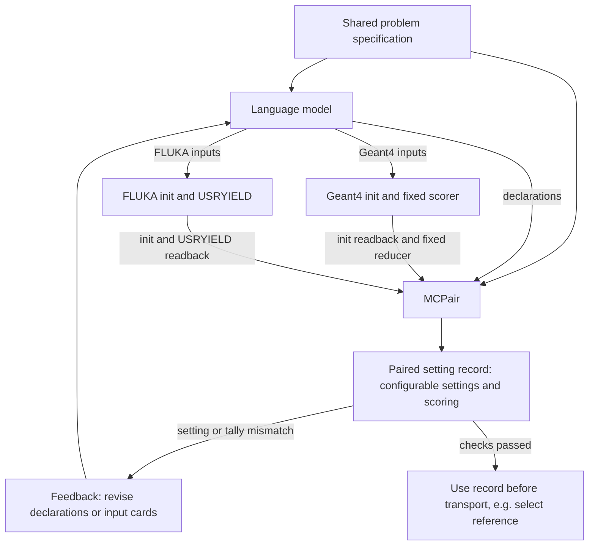
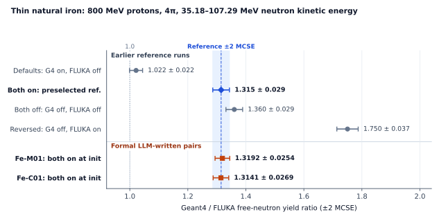

# MCPair

MCPair checks physics settings and scoring definitions in paired Geant4 and FLUKA inputs written by a language model. It verifies both inputs and model declarations against a shared problem specification, each code's initialization output, and each scorer's calculation rules. The output is a **paired setting record** summarizing the effective configurable settings across both codes while marking 19 internal model settings as unverified per input. [Example record](evidence/records/Fe-M01-r2.json) · [Physics checklist](evidence/settings-source/checklist.json)

This repository includes iron and lead records, selected checker source files, and an offline reproduction of the archived results. Checking new inputs in full requires additional runtime components. The records retain their original Chinese titles. For each code, `effective` gives the setting the checker found and `confirmed` indicates whether the declaration agrees with it. The row-level `aligned` field is `null` for code-specific settings. The 19 internal settings appear in a separate register. [Paired records](evidence/records/) · [Checker source](evidence/settings-source/) · [Offline reproduction](#offline-reproduction)



## Examples

**Fe-M02: cross section instead of yield.** In a retrospective scoring replay of an earlier development case, all 13 physics checks had passed and both scorers shared the same target surface and neutron energy–angle grid. From FLUKA's initialization output, MCPair flagged a mismatch between the required per-primary yield and the actual `USRYIELD` scorer. [Physics checks](evidence/records/M02-r5-table.md) · [Cards and FLUKA output](evidence/records/early-Fe-scoring.json#L85-L129) · [Scoring record](evidence/records/early-Fe-scoring.json#L274-L339)

| Code | Problem requirement / archived declaration | Verified scorer basis |
| --- | --- | --- |
| Geant4 | Per-primary yield required. No separate declaration in the archived record. | Fixed host computes a per-primary yield |
| FLUKA | Model described a per-primary yield | Initialization output gives `d²σ/(dE dΩ)` with an adopted cross-section factor of **20.534 mb** |

**Iron runs: choosing a reference before transport.** Earlier 800 MeV proton runs on thin natural iron scored outward free-neutron crossings per incident proton over 4π in the 35.18064–107.29429 MeV kinetic energy window. Initialization records for Fe-M01 and Fe-C01 showed clustering enabled in both codes, so the production plan fixed the both-on reference before transport; both subsequent ratios agreed with it within two combined Monte Carlo standard errors. [Four clustering combinations](evidence/experiments/lower-half-case/presentation-20261114/four-cells.csv#L1-L9) · [Fe-M01 record](evidence/records/Fe-M01-r2.json#L48-L70) · [Fe-C01 record](evidence/records/Fe-C01-r2.json#L48-L70) · [Preselected reference](evidence/records/formal-transport-plan.json#L14-L25)



*The shaded band extends two Monte Carlo standard errors (MCSE) on either side of the reference ratio. The pre-registered compatibility test combines the standard errors of the reference and production ratios.* [Figure script](assets/plot_iron_ratios.py)

## Offline reproduction

Run from the repository root on macOS or Linux with Python 3.13. After NumPy is installed, `evidence/verify.py` runs offline.

```sh
python3 -m venv results/venv
results/venv/bin/python -m pip install numpy==2.2.6
results/venv/bin/python -IB evidence/verify.py --out results/run-1
```

In `results/run-1/verification.json`, `formal_transport` gives `ratio` values of **1.3192** for Fe-M01 and **1.3141** for Fe-C01. Each ratio divides the mean yield of 800 Geant4 batches by the mean yield of 40 FLUKA streams. For one Fe-M01 Geant4 batch and one independent FLUKA stream, the script also reconstructs yields from individual crossings and native `USRYIELD` cells. All other production yields are supplied per batch or stream. Use a fresh output directory for each run. [Verification report from this release](verification.json) · [Native outputs](evidence/example/formal-g000-f00/) · [Archived yields](evidence/units/)

The simulations used Geant4 11.4.3 and CERN FLUKA 4-5.2. For Geant4 see S. Agostinelli et al., *Nucl. Instrum. Meth. A* **506**, 250–303 (2003), J. Allison et al., *IEEE Trans. Nucl. Sci.* **53**, 270–278 (2006), and J. Allison et al., *Nucl. Instrum. Meth. A* **835**, 186–225 (2016). For FLUKA see C. Ahdida et al., *Frontiers in Physics* **9**, 788253 (2022), and G. Battistoni et al., *Annals of Nuclear Energy* **82**, 10–18 (2015). [Geant4 publications](https://geant4.web.cern.ch/about/publications.html) · [CERN FLUKA](https://fluka.cern/) · [FLUKA references](https://fluka.cern/documentation/references)

## Licensing

MCPair code and the physics checklist use the MIT License. Original research data, records, documentation and figures use CC BY 4.0. The archived FLUKA output files and quoted third-party material retain their original notices and are excluded from both grants. [Licence scope and attribution](LICENSE)
